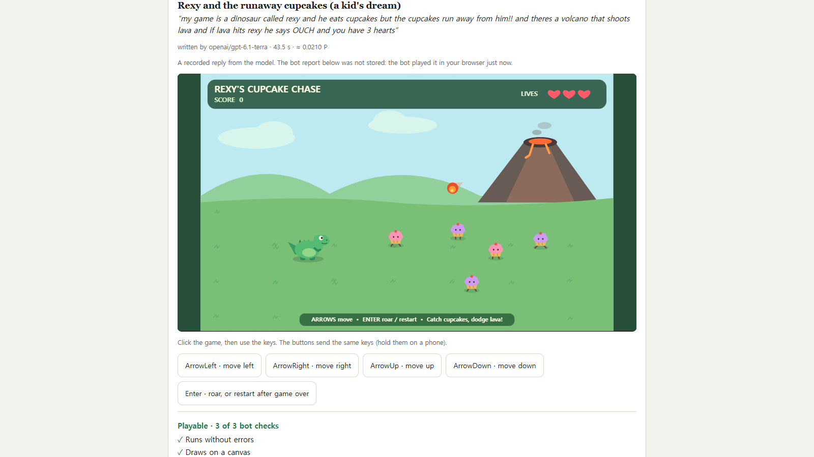

# Dream Arcade

Describe the game you dream of. A model writes it, a bot plays it in your browser and checks every key, then you play it and share it.

Live: https://patbing.github.io/dream-arcade/ · Built for Pollinations quest #20021.

## What it does

1. You describe a game in your own words, kid spelling welcome.
2. `openai/gpt-6.1-terra` writes one self-contained HTML game: a canvas, keys, lives, a score, and a list of its keys with what each one does (`window.__play`).
3. A bot plays it before you do, in a sandboxed frame with no network, on a fake clock with a fixed seed: one minute with no keys, each declared key held for 1.5 s, then 30 s of random keys. It compares a 32×18 brightness picture of the canvas between runs, so a key that changes nothing on screen is a dead key, whatever the game says about itself.
4. If the bot finds a crash, no canvas or a dead key, its findings go back to the model once for a repair. The report shows both versions.
5. You play it with the keyboard or with on-screen buttons on a phone. Ask for a change ("make the lava slower"); the bot plays the new version and flags anything that worked before and broke, with Undo.
6. Share: the whole game is compressed into the link (nothing is stored on a server), or download it as one `.html` file.

Before sign-in, five recorded games replay real model replies, and the bot plays each one in your browser when you open it.

This follows the post the quest links, where the uncle had the model write a bot that played every stage and checked the screenshots. Here the bot is ordinary code, so its verdict does not depend on the model that wrote the game.

## Why this model

A pilot of five dreams on two free models ([docs/pilot.md](docs/pilot.md)): `openai/gpt-6.1-terra` wrote a game in 31 to 43 s for about 0.02 Pollen and all of its games passed the bot. `deepseek/deepseek-v4.1-flash` took 2 to 4.5 minutes and three of five requests ended without a game.

## Safety

Generated games are untrusted code. They run in an `<iframe sandbox="allow-scripts">` (an opaque origin: no access to this page, its storage or your key) with a Content-Security-Policy that blocks all network, put in front of the game's own markup. On-screen buttons reach the game only through `postMessage` with a per-frame token. Downloaded games keep the same no-network policy.

## Run it

Static files, no build. Serve the folder and open it. Sign in with Pollinations Connect to make a game; you pay with your own Pollen and the default model is free-tier. The page will not send a request that could push one visit past 0.5 Pollen (`CAP` in `js/config.js`). Tests: `npm test`. `tools/harness.html` runs the bot on four handwritten games (working, dead key, a frozen screen that lies about its state, a crash).

## Files

- `js/dream.js` the contract the model is given, repair and change messages, reading the game out of a reply (pure, tested)
- `js/judge.js` the bot's run plans and verdicts from screen samples (pure, tested)
- `js/harness.js` the sandboxed frame, fake clock, key presses and screen samples
- `js/net.js` every network call; `js/app.js` the page; `recordings/` the recorded games
